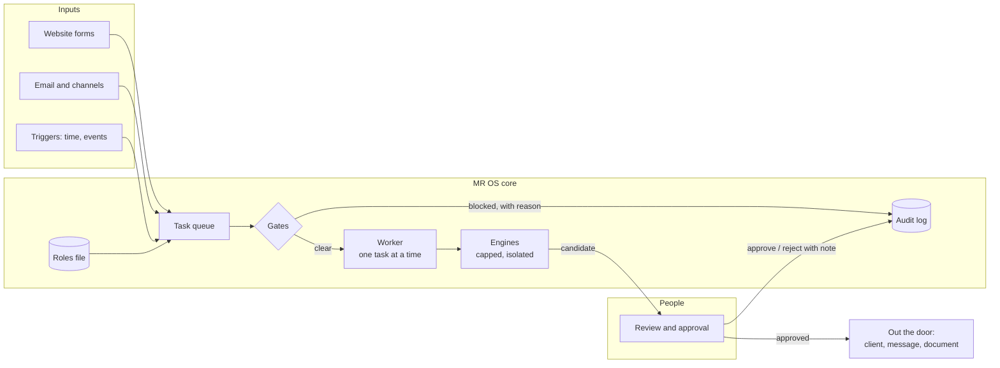

# MR OS Blueprint

**How to run a firm where people and AI agents work side by side, without losing control of what goes out the door.**

[Leer en español](README.es.md)

MR OS is the internal operating system of [Morrigan Rook](https://morriganrook.com), a business consultancy. A small senior team works with a few dozen AI agents. The agents gather, analyze and draft; people judge, decide and sign. This repository is the public blueprint of that system: the principles, the architecture, the patterns, and a small reference implementation you can run in a minute.

It is not MR OS itself. There is no client data here, no prices, no contracts and none of our agents' instructions. The architecture, the rules and the code that enforces them are all here.

---

## The ideas in one page

1. **The agent proposes, a person approves.** Every agent output is a *candidate*. Approving means "I sign this". Rejecting requires a note that says what was wrong.
2. **Roles as code.** Every seat in the firm, human or AI, is a role with a supervisor, a written list of what it does and what it never does, and a status. Empty seats exist as vacant roles, so work has an owner from day one.
3. **Gates, not reminders.** A prompt can ask an agent to behave. A gate makes the wrong thing impossible to save, send or run.
4. **Data is never an instruction.** Emails, applications and documents are material to work on. Anything external is fenced and labeled as data.
5. **Versioned or it doesn't exist.** Every output records the exact version of the agent and the engine that produced it.
6. **Capped, isolated engines.** Agents run one at a time, with a daily cap, in an environment that never receives paid API keys or the server's secrets.
7. **Watch the human correction rate.** Roughly 10–25 % of outputs should need a correction. Below that, people probably stopped reviewing; above it, recalibrate the agent instead of fixing it by hand forever.
8. **Agents have names, never a disguise.** A human-sounding name makes collaboration natural. Agents are labeled as AI everywhere and never claim to be a person.
9. **The method lives in one place.** Scales, rules and templates are written once and referenced by every agent. Changing the method is one edit, not ten.
10. **Everything leaves a trace.** Decisions, approvals, rejections and gate blocks go to an append-only audit log.

## Architecture



The production system adds a web app for people (approvals, dashboards, the method step by step), integrations with the firm's tools, a document engine with versioned legal templates, and a deployment pipeline. The patterns are the same.

## Run the reference

Requires Node.js 22.13 or newer. No dependencies to install.

```bash
npm run demo   # a walkthrough with a fictional firm and a mock engine
npm test       # the rules, as tests
```

The demo shows an application with a prompt-injection attempt being scored by an agent, a person approving with a correction, outbound messages stopped by a gate, a task that waits until a client's account is formally opened, and a high score refused because it has no document behind it.

## What's inside

| Path | What it shows |
|---|---|
| [`reference/src/team.ts`](reference/src/team.ts) | Roles as code, and a sync that never undoes a decision made in the app |
| [`reference/src/tasks.ts`](reference/src/tasks.ts) | Task types, the lifecycle, approval with notes, the correction rate |
| [`reference/src/gates.ts`](reference/src/gates.ts) | Evidence, privacy and outbound gates |
| [`reference/src/engines.ts`](reference/src/engines.ts) | Pluggable engines, allowlisted environment, daily caps |
| [`reference/src/untrusted.ts`](reference/src/untrusted.ts) | Fencing external data, recovering JSON from model answers |
| [`reference/src/versioning.ts`](reference/src/versioning.ts) | Automatic versions from the instruction files |
| [`reference/src/worker.ts`](reference/src/worker.ts) | The one-at-a-time worker |
| [`reference/agents/`](reference/agents/) | Sample agent instructions (fictional firm) |
| [`docs/en/patterns.md`](docs/en/patterns.md) | Each pattern in depth, with lessons from production |
| [`docs/en/build-your-own.md`](docs/en/build-your-own.md) | A step-by-step guide to build a similar system for your organization |

## About engines and vendor terms

The reference ships a mock engine and a generic command-line adapter. MR OS runs its agents through the official CLIs of AI vendors under the firm's own subscriptions, one task at a time and with daily caps, rather than on pay-per-use APIs. If you build something similar, read each vendor's current terms for the access mode you choose. They differ between vendors and change over time.

## What this is not

- Not a product or a hosted service. It's a blueprint and a teaching implementation.
- Not legal advice. The compliance rules shown are examples of the kind of checks that belong in code; your obligations depend on where you operate.
- Not a way around human judgment. Every pattern here exists to keep a person accountable for what leaves the firm.

## License and attribution

Apache License 2.0. You can use, modify and distribute this work, including commercially. Keep the [NOTICE](NOTICE) file, which credits Morrigan Rook as the origin. The license does not grant rights to the Morrigan Rook or MR OS names and logos.

Built and maintained by [Morrigan Rook](https://morriganrook.com).
